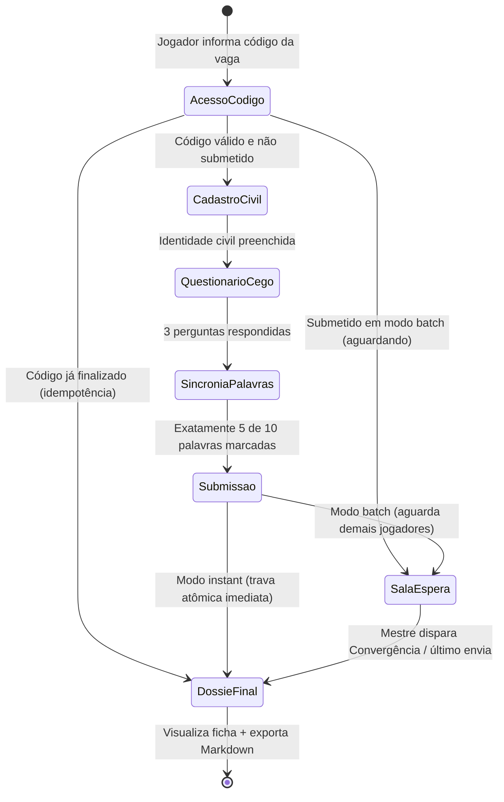

---
tags:
  - rpg
  - marvel-multiverse-rpg
  - planejamento-tecnico
  - javascript
  - limbo-os
  - sorteio
sistema: Marvel Multiverse RPG (d616)
status: plano-arquitetural-pronto
---

# Plano Técnico — Sistema de Despertar de Poderes (JavaScript para Limbo OS)

Este documento especifica a arquitetura completa, o modelo de dados, o motor de cálculo/alocação em **JavaScript puro (ES Modules, zero dependências)** e o contrato de integração para embarcar o teste de seleção de poderes de [[Convergência Macabra]] no **Limbo OS**.

---

## 1. Requisitos e Garantias do Sistema

1. **Acesso Controlado por Código:** O Mestre cria uma sessão no Limbo OS e gera códigos de acesso individuais (ex.: `LIMBO-A1B2`) vinculados à mesma sala (máximo de 5 vagas).
2. **Proibição Absoluta de Repetição (Bijeção 1-para-1):** Cada uma das 5 fichas (`melee`, `agility`, `ego`, `logic`, `vigilance`) só pode ser atribuída a **um único jogador** por sessão.
3. **Teste Cego Anti-Viés:** Alternativas das perguntas (`A–E`) e a lista das **10 palavras** são embaralhadas com seed única por jogador na interface, impedindo que alguém deduza o padrão das respostas.
4. **Idempotência (Anti-Refazer):** Após submeter, o código do jogador fica travado (`locked: true`). Recarregar a página ou logar de novo devolve o mesmo resultado gravado, sem permitir novo sorteio.
5. **Dois Modos de Resolução Suportados:**
   * **Modo `batch` (Lote / Recomendado):** Todos respondem; quando os $N$ jogadores ($1 \le N \le 5$) terminam (ou o Mestre aciona a convergência), o motor calcula a **alocação global ótima** entre todas as permutações válidas ($5! = 120$), garantindo máxima justiça.
   * **Modo `instant` (Assíncrono / Tempo Real):** Para jogadores respondendo em horários diferentes; cada envio reserva atomicamente a melhor ficha ainda livre no pool da sessão, com controle de concorrência (`version` / transação) para evitar colisões simultâneas.

---

## 2. Fluxo de Telas e Máquina de Estados (UX no Limbo OS)



### Etapas da Interface
1. **Terminal de Acesso:** Input de código (`slotCode`). Valida existência, expiração e estado (`pending`, `submitted`, `revealed`).
2. **Fase 1 — Identidade Civil:** Campos: `playerName`, `civilName`, `age`, `occupation`, `visualAppearance`, `personality`, `prePowerHistory`.
3. **Fase 2 — Protocolo de Sincronia (Cego):**
   * **3 Perguntas de Múltipla Escolha** (alternativas embaralhadas por jogador; nenhum rótulo de atributo visível).
   * **Grade de 10 Palavras** (embaralhadas; contador rígido `selectedWords.length === 5` para liberar envio).
4. **Fase 3 — Sala de Convergência (somente Modo `batch`):** Exibe barra de progresso (`X / N sujeitos sincronizados`) sem revelar respostas de terceiros.
5. **Fase 4 — Dossiê de Despertar:** Revela Origem (`Mutant` ou `Weird Science`), Atributos M.A.R.V.E.L., Estatísticas Derivadas, 4 Traits, 18 Poderes detalhados e campos de personalização estética específicos do arquétipo (ex.: arma/projétil no `agility`, cor/aroma da névoa no `ego`, detalhes do sonho no `logic`).
6. **Painel do Mestre (GM Console):** Criação da sessão, geração dos 5 códigos, seleção de modo (`batch` vs `instant`), visualização da matriz de afinidade $N \times 5$, log auditável de desempates d616, botão **"Disparar Convergência"** e botão **"Exportar Fichas (.md Obsidian)"**.

---

## 3. Estrutura de Arquivos Modular (JavaScript Puro)

Estrutura recomendada para acoplar como módulo isolado dentro do Limbo OS (funciona em Node.js, Next.js, Vite/React ou Vanilla JS):

```text
src/modules/marvel-awakening/
├── data/
│   ├── archetypes.js        # Definição completa das 5 fichas (stats, traits, 18 poderes)
│   └── quizConfig.js        # 3 perguntas + 10 palavras + pesos e bônus de sincronia
├── engine/
│   ├── prng.js              # Seeded PRNG + Fisher-Yates (embaralhamento cego por jogador)
│   ├── scoring.js           # Cálculo de afinidade, pares sincronizados e ranking 1º–5º
│   ├── marvelDie.js         # Rolagem d616 (1 = 6 Fantástico) e desempate auditável
│   ├── allocator.js         # Resolvedor Batch (ótimo global 5!) + Resolvedor Instant
│   └── obsidianExporter.js  # Gera o arquivo .md final pronto para o vault
├── services/
│   ├── sessionService.js    # Regras de negócio (criar sala, validar código, submeter, travar)
│   └── storageAdapter.js    # Interface plugável (LocalStorage / REST API / DB do Limbo OS)
└── tests/
    └── allocator.test.js    # Testes determinísticos de borda e concorrência
```

---

## 4. Contrato de Dados (Schemas JavaScript)

```javascript
/**
 * @typedef {"melee" | "agility" | "ego" | "logic" | "vigilance"} ArchetypeId
 * @typedef {"batch" | "instant"} AllocationMode
 * @typedef {"pending" | "submitted" | "revealed"} SlotStatus
 */

/**
 * Estado persistido de uma Sessão (Sala) no Limbo OS
 * @typedef {Object} AwakeningSession
 * @property {string} sessionId               - UUID da sessão
 * @property {string} campaignName            - Ex: "Convergência Macabra"
 * @property {string} masterCode              - Código secreto do Painel do Mestre
 * @property {AllocationMode} mode            - "batch" (recomendado) ou "instant"
 * @property {number} maxPlayers              - Até 5
 * @property {number} version                 - Controle de concorrência otimista (incrementa a cada gravação)
 * @property {boolean} converged              - true quando as fichas foram reveladas no modo batch
 * @property {ArchetypeId[]} availablePool    - Fichas ainda livres (usado no modo instant)
 * @property {Record<string, PlayerSlot>} slots - Mapa indexado por slotCode (ex: "X616-K9M2")
 * @property {AuditEntry[]} auditLog          - Registro cronológico de submissões e desempates d616
 */

/**
 * Dados de um Jogador individual (1 vaga = 1 código único)
 * @typedef {Object} PlayerSlot
 * @property {string} slotCode                - Código único entregue ao jogador
 * @property {SlotStatus} status              - "pending" | "submitted" | "revealed"
 * @property {boolean} locked                 - Impede reenvio após submissão
 * @property {Object|null} civilIdentity      - Dados da Fase 1 preenchidos pelo jogador
 * @property {Record<string, string>|null} answers - Mapa { q1: "opt_a", q2: "opt_c", q3: "opt_b" }
 * @property {string[]} selectedWordIds       - Exatamente 5 IDs de palavras
 * @property {Record<ArchetypeId, number>|null} scores - Pontuação calculada nas 5 fichas
 * @property {ArchetypeId[]|null} ranking     - Ordem do 1º ao 5º lugar do jogador
 * @property {ArchetypeId|null} assignedArchetypeId - Ficha final atribuída (única na sessão)
 * @property {Record<string, string>} customFlavor  - Escolhas livres pós-revelação (arma, cor da névoa etc.)
 * @property {string|null} submittedAt        - ISO timestamp
 */
```

---

## 5. Implementação Detalhada do Motor em JavaScript

### 5.1 Configuração das Perguntas e Palavras (`data/quizConfig.js`)

```javascript
export const ARCHETYPE_IDS = ["melee", "agility", "ego", "logic", "vigilance"];

export const SCORING_RULES = {
  questionPrimaryPoints: 2,
  questionSecondaryPoints: 1, // aplicado apenas na q1
  wordMatchPoints: 1,
  wordPairSyncBonus: 1,       // +1 extra se acertar as 2 palavras da mesma ficha
  requiredWordCount: 5,
};

export const QUESTIONS = [
  {
    id: "q1",
    prompt: "Quando tudo dá errado e o perigo é imediato, qual é o primeiro reflexo do seu personagem?",
    options: [
      { id: "q1_melee", text: "Avançar para proteger quem está perto, firmar o pé e segurar o tranco de frente.", primary: "melee", secondary: "vigilance" },
      { id: "q1_agility", text: "Ganhar distância, buscar um ângulo seguro e lidar com a ameaça de longe com precisão.", primary: "agility", secondary: "logic" },
      { id: "q1_ego", text: "Sair do campo de visão, despistar o agressor ou ganhar tempo confundindo a situação.", primary: "ego", secondary: "agility" },
      { id: "q1_logic", text: "Analisar o ambiente com frieza, procurar uma falha no problema e organizar quem está em volta.", primary: "logic", secondary: "ego" },
      { id: "q1_vigilance", text: "Reagir no susto antes mesmo de pensar, guiado por um arrepio ou percepção súbita do ambiente.", primary: "vigilance", secondary: "melee" },
    ],
  },
  {
    id: "q2",
    prompt: "O que mais marcou a história passada do seu personagem até hoje?",
    options: [
      { id: "q2_melee", text: "Trabalho pesado, esporte de contato, lutas ou a necessidade constante de aguentar pressão física.", primary: "melee" },
      { id: "q2_agility", text: "Atividades que exigiam mira, coordenação fina, reflexo manual ou a sensação de precisar sempre escapar.", primary: "agility" },
      { id: "q2_ego", text: "Isolamento, segredos guardados, sensação de não pertencer ou lidar com pessoas difíceis.", primary: "ego" },
      { id: "q2_logic", text: "Estudos intensos, curiosidade fora do comum ou um sonho/evento estranho que nunca soube explicar.", primary: "logic" },
      { id: "q2_vigilance", text: "Estado constante de alerta, hipervigilância, intuição aguçada ou um susto que mudou seus sentidos.", primary: "vigilance" },
    ],
  },
  {
    id: "q3",
    prompt: "Em um grupo tentando sobreviver a uma crise, qual papel combina mais com a personalidade dele?",
    options: [
      { id: "q3_melee", text: "O escudo da linha de frente que não recua.", primary: "melee" },
      { id: "q3_agility", text: "O especialista ágil que resolve alvos difíceis sem se expor.", primary: "agility" },
      { id: "q3_ego", text: "O infiltrador ou distraidor que controla o que os outros percebem.", primary: "ego" },
      { id: "q3_logic", text: "O estrategista que monta o plano e protege os companheiros.", primary: "logic" },
      { id: "q3_vigilance", text: "O batedor/sentinela que percebe ameaças escondidas antes de todo mundo.", primary: "vigilance" },
    ],
  },
];

export const SYNC_WORDS = [
  { id: "w_nevoa", label: "Névoa", archetype: "ego" },
  { id: "w_precisao", label: "Precisão", archetype: "agility" },
  { id: "w_impacto", label: "Impacto", archetype: "melee" },
  { id: "w_sonho", label: "Sonho", archetype: "logic" },
  { id: "w_instinto", label: "Instinto", archetype: "vigilance" },
  { id: "w_segredo", label: "Segredo", archetype: "ego" },
  { id: "w_fuga", label: "Fuga", archetype: "agility" },
  { id: "w_resistencia", label: "Resistência", archetype: "melee" },
  { id: "w_pressagio", label: "Presságio", archetype: "vigilance" },
  { id: "w_estrategia", label: "Estratégia", archetype: "logic" },
];
```

### 5.2 Embaralhamento Cego Determinístico (`engine/prng.js`)

Garante que cada código de jogador veja as alternativas e as 10 palavras em uma ordem diferente, sem que a ordem mude se ele recarregar a aba antes de enviar.

```javascript
function hashSeed(str) {
  let h = 2166136261 >>> 0;
  for (let i = 0; i < str.length; i++) {
    h ^= str.charCodeAt(i);
    h = Math.imul(h, 16777619);
  }
  return h >>> 0;
}

export function mulberry32(seedStr) {
  let a = hashSeed(seedStr);
  return function next() {
    a |= 0;
    a = (a + 0x6d2b79f5) | 0;
    let t = Math.imul(a ^ (a >>> 15), 1 | a);
    t = (t + Math.imul(t ^ (t >>> 7), 61 | t)) ^ t;
    return ((t ^ (t >>> 14)) >>> 0) / 4294967296;
  };
}

export function shuffleWithSeed(items, seedStr) {
  const arr = [...items];
  const rand = mulberry32(seedStr);
  for (let i = arr.length - 1; i > 0; i--) {
    const j = Math.floor(rand() * (i + 1));
    [arr[i], arr[j]] = [arr[j], arr[i]];
  }
  return arr;
}
```

### 5.3 Cálculo de Afinidade e Validação (`engine/scoring.js`)

```javascript
import { ARCHETYPE_IDS, QUESTIONS, SYNC_WORDS, SCORING_RULES } from "../data/quizConfig.js";

export function calculateAffinity(answers, selectedWordIds) {
  // 1. Validação estrita
  for (const q of QUESTIONS) {
    if (!answers?.[q.id]) {
      throw new Error(`Pergunta obrigatória não respondida: ${q.id}`);
    }
  }
  const uniqueWords = [...new Set(selectedWordIds || [])];
  if (uniqueWords.length !== SCORING_RULES.requiredWordCount) {
    throw new Error(`É necessário selecionar exatamente ${SCORING_RULES.requiredWordCount} palavras distintas.`);
  }

  // 2. Inicialização dos contadores
  const scores = Object.fromEntries(ARCHETYPE_IDS.map((id) => [id, 0]));
  const wordHits = Object.fromEntries(ARCHETYPE_IDS.map((id) => [id, 0]));

  // 3. Soma das perguntas
  for (const q of QUESTIONS) {
    const chosen = q.options.find((opt) => opt.id === answers[q.id]);
    if (!chosen) throw new Error(`Alternativa inválida para ${q.id}: ${answers[q.id]}`);

    scores[chosen.primary] += SCORING_RULES.questionPrimaryPoints;
    if (chosen.secondary) {
      scores[chosen.secondary] += SCORING_RULES.questionSecondaryPoints;
    }
  }

  // 4. Soma das palavras + Bônus de Sincronia (par completo)
  const wordMap = new Map(SYNC_WORDS.map((w) => [w.id, w]));
  for (const wordId of uniqueWords) {
    const word = wordMap.get(wordId);
    if (!word) throw new Error(`Palavra inválida: ${wordId}`);
    scores[word.archetype] += SCORING_RULES.wordMatchPoints;
    wordHits[word.archetype] += 1;
  }

  const matchedPairs = [];
  for (const arch of ARCHETYPE_IDS) {
    if (wordHits[arch] === 2) {
      scores[arch] += SCORING_RULES.wordPairSyncBonus;
      matchedPairs.push(arch);
    }
  }

  // 5. Ranking pessoal completo (1º ao 5º lugar)
  const ranking = [...ARCHETYPE_IDS].sort((a, b) => scores[b] - scores[a]);

  return { scores, ranking, wordHits, matchedPairs };
}
```

### 5.4 Dado Marvel `d616` Auditável (`engine/marvelDie.js`)

```javascript
export function rollMarvelDie(rng = Math.random) {
  const face = Math.floor(rng() * 6) + 1;
  return {
    face,
    value: face === 1 ? 6 : face,
    isFantastic: face === 1,
  };
}

/**
 * Desempata N candidatos usando a regra oficial do Dado Marvel:
 * 1 (Fantástico) > 6 > 5 > 4 > 3 > 2. Rerrola automaticamente empates no topo.
 */
export function breakTieWithMarvelDie(candidateIds, rng = Math.random) {
  let pool = [...candidateIds];
  const rounds = [];

  while (pool.length > 1) {
    const rolls = pool.map((id) => ({ id, ...rollMarvelDie(rng) }));
    rounds.push(rolls);

    const hasFantastic = rolls.some((r) => r.isFantastic);
    if (hasFantastic) {
      pool = rolls.filter((r) => r.isFantastic).map((r) => r.id);
    } else {
      const maxVal = Math.max(...rolls.map((r) => r.value));
      pool = rolls.filter((r) => r.value === maxVal).map((r) => r.id);
    }
  }

  return { winnerId: pool[0], rounds };
}
```

### 5.5 Alocador 1-para-1 Sem Repetição (`engine/allocator.js`)

Para $N \le 5$ jogadores e $5$ fichas, há no máximo **$5! = 120$** atribuições sem repetição. Testar todas em memória executa em menos de **0,1 ms** e encontra o **ótimo global exato**, eliminando injustiças de ordem de chegada.

```javascript
import { ARCHETYPE_IDS } from "../data/quizConfig.js";
import { breakTieWithMarvelDie } from "./marvelDie.js";

function getPermutations(items, k) {
  if (k === 0) return [[]];
  const result = [];
  for (let i = 0; i < items.length; i++) {
    const current = items[i];
    const rest = [...items.slice(0, i), ...items.slice(i + 1)];
    for (const tail of getPermutations(rest, k - 1)) {
      result.push([current, ...tail]);
    }
  }
  return result;
}

/**
 * MODO BATCH (Recomendado): Atribui fichas únicas para 1..5 jogadores
 * maximizando afinidade global, equidade mínima e 1ºs lugares.
 */
export function resolveBatchAssignments(submissions, rng = Math.random) {
  if (submissions.length === 0 || submissions.length > ARCHETYPE_IDS.length) {
    throw new Error(`Número inválido de submissões: ${submissions.length}`);
  }

  const permutations = getPermutations(ARCHETYPE_IDS, submissions.length);

  const evaluated = permutations.map((perm, idx) => {
    const assignedScores = perm.map((arch, i) => submissions[i].scores[arch]);
    const totalScore = assignedScores.reduce((acc, s) => acc + s, 0);
    const minScore = Math.min(...assignedScores);
    const firstChoicesHit = perm.filter(
      (arch, i) => submissions[i].scores[arch] === Math.max(...Object.values(submissions[i].scores))
    ).length;

    return {
      permId: `perm_${idx}`,
      perm,
      totalScore,
      minScore,
      firstChoicesHit,
    };
  });

  // Ordenação lexicográfica de justiça:
  // 1) Maior soma total  2) Maior nota mínima (evita deixar alguém com 0)  3) Mais 1ºs lugares
  evaluated.sort(
    (a, b) =>
      b.totalScore - a.totalScore ||
      b.minScore - a.minScore ||
      b.firstChoicesHit - a.firstChoicesHit
  );

  const best = evaluated[0];
  const tiedTop = evaluated.filter(
    (e) =>
      e.totalScore === best.totalScore &&
      e.minScore === best.minScore &&
      e.firstChoicesHit === best.firstChoicesHit
  );

  let chosen = best;
  let tieBreakAudit = null;

  if (tiedTop.length > 1) {
    const tie = breakTieWithMarvelDie(
      tiedTop.map((t) => t.permId),
      rng
    );
    chosen = tiedTop.find((t) => t.permId === tie.winnerId);
    tieBreakAudit = {
      reason: "Empate matemático entre alocações ótimas equivalentes",
      tiedPermutationsCount: tiedTop.length,
      d616Rounds: tie.rounds,
      winnerPermId: tie.winnerId,
    };
  }

  const assignments = {};
  submissions.forEach((sub, i) => {
    const arch = chosen.perm[i];
    const isUnexpectedAwakening = sub.scores[arch] <= 1;
    assignments[sub.slotCode] = {
      archetypeId: arch,
      affinityScore: sub.scores[arch],
      isUnexpectedAwakening,
    };
  });

  return {
    assignments,
    metrics: {
      totalScore: chosen.totalScore,
      minScore: chosen.minScore,
      firstChoicesHit: chosen.firstChoicesHit,
    },
    tieBreakAudit,
  };
}

/**
 * MODO INSTANT (Assíncrono): Aloca imediatamente a melhor ficha ainda livre
 * no pool da sessão (deve ser executado dentro de trava atômica / transação).
 */
export function resolveInstantAssignment(submission, availablePool, rng = Math.random) {
  if (!availablePool || availablePool.length === 0) {
    throw new Error("Todas as 5 fichas desta sessão já foram atribuídas.");
  }

  const maxScore = Math.max(...availablePool.map((arch) => submission.scores[arch]));
  const topCandidates = availablePool.filter((arch) => submission.scores[arch] === maxScore);

  let chosenArchetype = topCandidates[0];
  let tieBreakAudit = null;

  if (topCandidates.length > 1) {
    const tie = breakTieWithMarvelDie(topCandidates, rng);
    chosenArchetype = tie.winnerId;
    tieBreakAudit = {
      reason: "Empate pessoal do jogador entre fichas disponíveis",
      candidates: topCandidates,
      d616Rounds: tie.rounds,
      winnerArchetype: chosenArchetype,
    };
  }

  return {
    archetypeId: chosenArchetype,
    affinityScore: maxScore,
    isUnexpectedAwakening: maxScore <= 1,
    remainingPool: availablePool.filter((id) => id !== chosenArchetype),
    tieBreakAudit,
  };
}
```

---

## 6. Integração com o Limbo OS (API, Códigos e Concorrência)

### 6.1 Geração de Códigos de Acesso
* **Formato amigável para digitar no celular/PC:** `PREFIXO-XXXX` sem caracteres ambíguos (`0/O`, `1/I/L`), usando alfabeto `ABCDEFGHJKMNPQRSTUVWXYZ23456789`.
* **1 Sessão = 1 `masterCode` + 5 `slotCodes` individuais.** Cada jogador recebe seu próprio código pelo WhatsApp/Discord — isso elimina a necessidade de cadastro de senha e garante rastreamento 1-para-1 por vaga.

### 6.2 Endpoints REST / RPC Sugeridos para o Limbo OS

| Endpoint | Método | Quem Chama | Função |
| :--- | :---: | :--- | :--- |
| `/api/marvel/sessions` | `POST` | Mestre | Cria sala (`mode: "batch" \| "instant"`), gera `masterCode` + 5 `slotCodes`. |
| `/api/marvel/slots/:slotCode` | `GET` | Jogador | Valida código; retorna perguntas/palavras já embaralhadas com `seed = slotCode` ou o Dossiê se já finalizado. |
| `/api/marvel/slots/:slotCode/submit` | `POST` | Jogador | Grava Identidade Civil + 3 respostas + 5 palavras, trava `locked: true` (idempotente). No modo `instant`, executa alocação sob transação. |
| `/api/marvel/sessions/:id/converge` | `POST` | Mestre | *(Modo `batch`)* Dispara `resolveBatchAssignments`, grava `assignedArchetypeId` em todos os slots submetidos e muda status para `revealed`. |
| `/api/marvel/slots/:slotCode/flavor` | `PATCH` | Jogador | Salva escolhas estéticas pós-revelação (ex.: arma escolhida, cor da fumaça, codinome). |
| `/api/marvel/sessions/:id/export` | `GET` | Mestre | Exporta as 5 fichas preenchidas em Markdown (`.md`) no padrão exato do Obsidian. |

### 6.3 Prevenção de Colisão / Race Condition (Crítico no Modo `instant`)
Para impedir que dois jogadores que cliquem em **"Enviar"** no mesmo milissegundo recebam a mesma ficha:
* **Se o Limbo OS usa banco SQL (Postgres/Supabase/SQLite):** Executar leitura de `availablePool` e gravação dentro de transação com `SELECT ... FOR UPDATE` na linha da sessão ou `UPDATE sessions SET ... , version = version + 1 WHERE id = $1 AND version = $2` (Optimistic Locking com retry automático de até 3 tentativas).
* **Se o Limbo OS usa Firestore:** Usar `runTransaction()` lendo o documento da sessão, calculando `resolveInstantAssignment` e atualizando `availablePool` + `slots[slotCode]` atomicamente.
* **No Modo `batch`:** O problema de corrida praticamente não existe, porque cada jogador escreve apenas na própria chave `slots[slotCode]` e somente o endpoint `/converge` (acionado uma única vez) grava os `assignedArchetypeId`.

---

## 7. Checklist de Testes Obrigatórios Antes de Subir no Limbo OS

1. **Cenário Ideal (5 distintos):** 5 jogadores respondem alinhados a 5 fichas diferentes → todos recebem sua 1ª opção, soma global máxima, `tieBreakAudit === null`.
2. **Cenário de Colisão Total (5 iguais):** Todos os 5 marcam exatamente as mesmas respostas e palavras de `melee` → o sistema atribui **5 fichas distintas** (0 repetições), registra o desempate `d616` no `auditLog` e marca `isUnexpectedAwakening: true` onde couber.
3. **Cenário Parcial (3 ou 4 jogadores):** Sessão com apenas 3 jogadores submetidos → `resolveBatchAssignments` aloca 3 fichas únicas e mantém as 2 restantes intocadas.
4. **Idempotência / F5:** Submeter o mesmo `slotCode` duas vezes retorna erro `409 Already Submitted` (ou o resultado já travado) sem alterar o pool nem re-rolar o dado.
5. **Embaralhamento Cego:** Verificar que `slotCode_1` e `slotCode_2` exibem as 5 alternativas e as 10 palavras em ordens diferentes, e que o mesmo `slotCode` mantém a mesma ordem ao recarregar a página antes do envio.
6. **Concorrência no Modo `instant`:** Disparar `Promise.all` com 5 envios simultâneos → confirmar exatamente 5 fichas únicas atribuídas e `availablePool.length === 0`.

---

## 8. Integração Direta com GitHub Actions (Implementado Neste Repositório)

O motor real em Node.js (`awakening-engine/`) e os 4 workflows do GitHub Actions (`.github/workflows/`) já estão criados e testados.

### Por que o GitHub Actions impede repetições sem banco externo
Todos os workflows de escrita compartilham o mesmo grupo de concorrência com **`cancel-in-progress: false`**:
```yaml
concurrency:
  group: marvel-awakening-state
  cancel-in-progress: false
```
Se dois jogadores clicarem em "Enviar" no **Limbo OS** no mesmo segundo, o GitHub Actions enfileira a 2ª execução até a 1ª terminar o `git commit && git push` em `state/session.json`.

### Como o Limbo OS chama o GitHub Actions (no servidor / API Route)
> **Segurança:** Nunca coloque o token do GitHub (`GITHUB_PAT` com permissão `contents: write`) no JavaScript do navegador. Crie um endpoint no backend do Limbo OS que chama:

```javascript
// 1) Submeter respostas de um jogador (dispara .github/workflows/awakening-submit.yml)
await fetch("https://api.github.com/repos/GoobinEXE/marvel-convergencia-macabra/dispatches", {
  method: "POST",
  headers: {
    Accept: "application/vnd.github+json",
    Authorization: `Bearer ${process.env.GITHUB_PAT}`,
    "Content-Type": "application/json",
  },
  body: JSON.stringify({
    event_type: "marvel-awakening-submit",
    client_payload: {
      slotCode: "X616-XXXX",
      playerName: "Nome do Jogador",
      civilName: "Nome Civil",
      civilAge: "26",
      civilOccupation: "Jornalista",
      visualAppearance: "Descrição visual",
      prePowerHistory: "Histórico",
      answers: { q1: "q1_melee", q2: "q2_ego", q3: "q3_logic" },
      selectedWordsCsv: "Névoa,Precisão,Impacto,Sonho,Instinto",
      autoConverge: true,
    },
  }),
});

// 2) Ler estado público sem spoilers (quem já escolheu / quiz embaralhado / dossiê revelado)
const res = await fetch(
  "https://api.github.com/repos/GoobinEXE/marvel-convergencia-macabra/contents/state/public-state.json",
  {
    headers: {
      Accept: "application/vnd.github.raw+json",
      Authorization: `Bearer ${process.env.GITHUB_PAT}`,
    },
    cache: "no-store",
  }
);
const publicState = await res.json();
```

